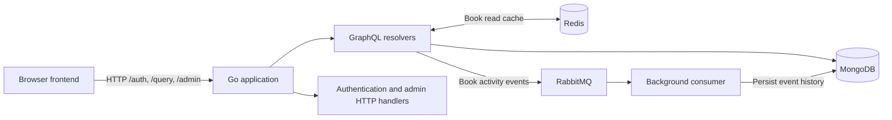

# Book Library

A full-stack personal book-library application built with **Go, GraphQL, MongoDB, Redis, and RabbitMQ**. Users can
organize their reading lists, track progress, save reviews and quotes, and set yearly reading goals. Administrators can
manage users and books across the platform.

## Features

### User experience

- Register and sign in with email and password
- Create, edit, delete, search, and filter books
- Organize books by `WANT_TO_READ`, `READING`, and `COMPLETED`
- Mark books as favorites
- Track page count and reading progress
- Add ratings, reviews, and saved quotes
- Edit profile information and profile photo URL
- View reading statistics and configure a yearly reading goal

### Administration

- Separate `USER` and `ADMIN` roles
- Admin dashboard for viewing and managing platform users
- View and manage books across user libraries
- Update user profiles, roles, and yearly reading goals
- User registration cannot assign the administrator role

### Backend and infrastructure

- GraphQL API powered by gqlgen
- MongoDB as the primary data store
- Redis read-through cache for book queries
- RabbitMQ events for book activity, persisted by a background consumer
- Circuit breaker around RabbitMQ publishing
- JWT authentication and database-backed role checks
- Request rate limits, input validation, body limits, and HTTP security headers
- Docker Compose environment for local development

## Technology stack

| Area                 | Technology                    |
|----------------------|-------------------------------|
| Backend              | Go                            |
| API                  | GraphQL, gqlgen               |
| Database             | MongoDB                       |
| Cache                | Redis                         |
| Messaging            | RabbitMQ                      |
| Resilience           | gobreaker                     |
| Frontend             | HTML, CSS, vanilla JavaScript |
| Local infrastructure | Docker Compose                |

## Architecture



MongoDB is the source of truth. Redis is an optional, short-lived cache; if Redis is unavailable, book reads fall back
to MongoDB. RabbitMQ is used for asynchronous book activity events. The consumer stores processed event records in
MongoDB's `activity_events` collection.

## Getting started

### Requirements

- Go version matching the `go` directive in `go.mod`
- Docker and Docker Compose
- Git

The simplest setup runs the API and its dependencies in Docker Compose.

### 1. Configure environment variables

Copy the example file:

```bash
cp .env.example .env
```

Edit `.env` and set unique values for at least:

```dotenv
JWT_SECRET=replace-with-a-random-secret-at-least-32-characters
ADMIN_EMAIL=admin@example.com
ADMIN_PASSWORD=replace-with-a-strong-password
RABBITMQ_USER=booklibrary
RABBITMQ_PASS=replace-with-a-strong-rabbitmq-password
```

Generate a strong JWT secret, for example:

```bash
openssl rand -base64 48
```

Never commit `.env` or real credentials. `.env.example` contains placeholders only.

### 2. Start the application

```bash
docker compose up -d --build
```

Check service health:

```bash
docker compose ps
docker compose logs -f api
```

Open the application:

- Frontend: <http://localhost:8080/>
- GraphQL Playground: <http://localhost:8080/playground> (only when `ENABLE_PLAYGROUND=true`)
- RabbitMQ Management: <http://localhost:15672/>

The default Compose configuration binds MongoDB, Redis, and RabbitMQ ports to localhost. RabbitMQ Management uses the
username and password configured in `.env`.

### 3. Stop the application

```bash
docker compose down
```

To also delete persistent database, broker, and cache volumes (destructive):

```bash
docker compose down -v
```

## Run the API outside Docker

You can run the Go API on your machine while Docker runs the dependencies:

```bash
docker compose up -d mongodb rabbitmq redis
go run ./cmd/server
```

The server loads `.env` from the project root for local development. Environment variables already present in the shell
take precedence.

## Authentication

The API exposes these endpoints:

| Method | Endpoint         | Purpose                        |
|--------|------------------|--------------------------------|
| `POST` | `/auth/register` | Create a regular user account  |
| `POST` | `/auth/login`    | Authenticate and receive a JWT |
| `POST` | `/query`         | GraphQL endpoint               |
| `GET`  | `/playground`    | Optional GraphQL Playground    |

### Register

```bash
curl -X POST http://localhost:8080/auth/register \
  -H "Content-Type: application/json" \
  -d '{"name":"Alex","nick":"alex","email":"alex@example.com","password":"strong-password-123"}'
```

### Log in

```bash
curl -X POST http://localhost:8080/auth/login \
  -H "Content-Type: application/json" \
  -d '{"email":"alex@example.com","password":"strong-password-123"}'
```

The response contains a token and public user information. Send the token in the `Authorization` header for protected
GraphQL requests:

```http
Authorization: Bearer YOUR_JWT_TOKEN
```

### Roles and access

- Public registration always creates a `USER`.
- The initial administrator is bootstrapped from `ADMIN_EMAIL` and `ADMIN_PASSWORD` when the application starts.
- An existing account is not silently promoted or have its password overwritten during bootstrap.
- The backend checks the account's current role in MongoDB on authenticated requests. Role changes therefore take effect
  without trusting stale role claims in a token.
- Regular users are restricted to their own profile and books. Administrators can access and manage platform-wide user
  and book data.

## GraphQL examples

With a valid bearer token, query the current user's books:

```graphql
query {
  books {
    id
    title
    author
    status
    isFavorite
    currentPage
    pageCount
  }
}
```

Create a book:

```graphql
mutation {
  createBook(input: {
    title: "The Hobbit"
    author: "J. R. R. Tolkien"
    status: WANT_TO_READ
    pageCount: 310
  }) {
    id
    title
    status
  }
}
```

Get reading statistics:

```graphql
query {
  myReadingStatistics {
    totalCompletedBooks
    currentlyReading
    wantToRead
    readingProgress
    yearlyReadingGoal
    completedThisYear
    yearlyGoalProgress
  }
}
```

Set a yearly goal:

```graphql
mutation {
  setYearlyReadingGoal(goal: 24) {
    yearlyReadingGoal
    completedThisYear
    yearlyGoalProgress
  }
}
```

The GraphQL schema is defined in `graph/schema.graphqls`.

## Caching and asynchronous events

### Redis

Redis caches book read operations for a short TTL. MongoDB remains authoritative. Cache keys include the query filter,
including the owner filter for regular users. Successful book mutations invalidate book cache entries. If Redis cannot
be reached during startup, the application continues with caching disabled.

### RabbitMQ

Successful book mutations publish activity events such as:

- `book.created`
- `book.updated`
- `book.deleted`
- `book.favorite_toggled`

The background consumer listens on a durable queue and stores event history in the MongoDB `activity_events` collection.
Event IDs are used to make persistence idempotent when RabbitMQ redelivers a message.

The publisher uses a circuit breaker that opens after repeated consecutive publishing failures and periodically permits
a trial request to determine whether RabbitMQ has recovered. MongoDB CRUD operations are not wrapped by this circuit
breaker.

## Security notes

The project includes several baseline protections:

- Password hashing with bcrypt
- Signed HS256 JWTs with an eight-hour expiration
- JWT signing secret validation at startup
- Current user and role reloaded from MongoDB during authentication
- Role-based authorization and owner-scoped book queries
- Per-IP token-bucket rate limiting
- Request body size limits and GraphQL complexity limits
- Input length and value validation
- HTTP timeouts and security headers
- GraphQL introspection and Playground disabled unless explicitly enabled

> **Warning:** This is a portfolio/demo project, not a security-audited production service.

## Development

Regenerate gqlgen code after changing the GraphQL schema:

```bash
go run github.com/99designs/gqlgen generate
```

## License

See [LICENSE](LICENSE).
